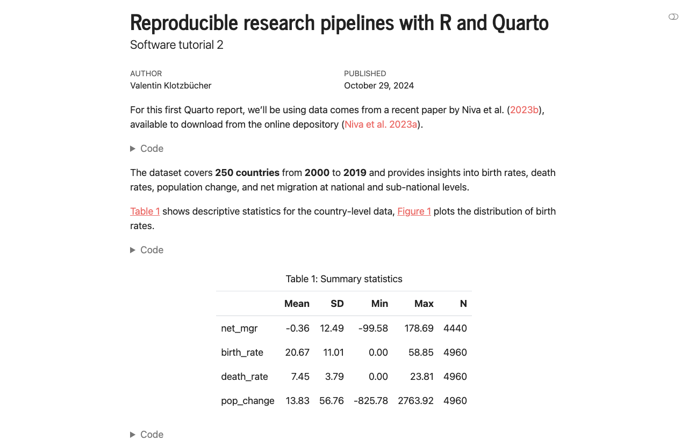
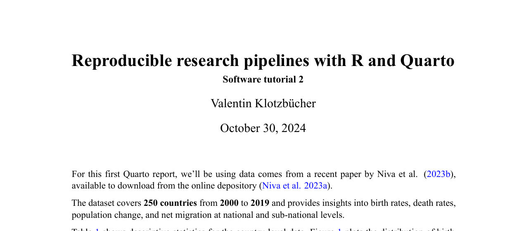
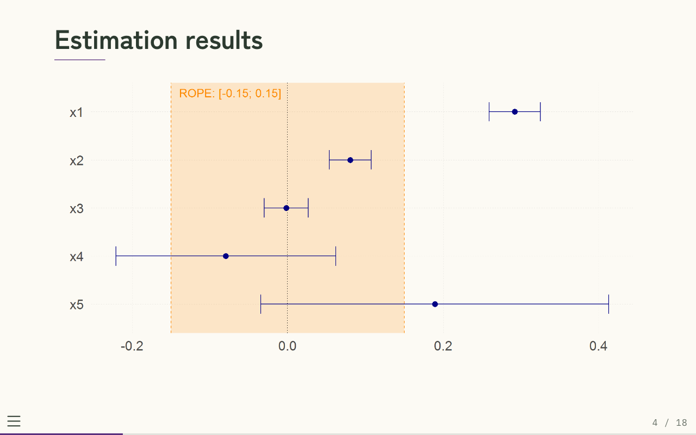
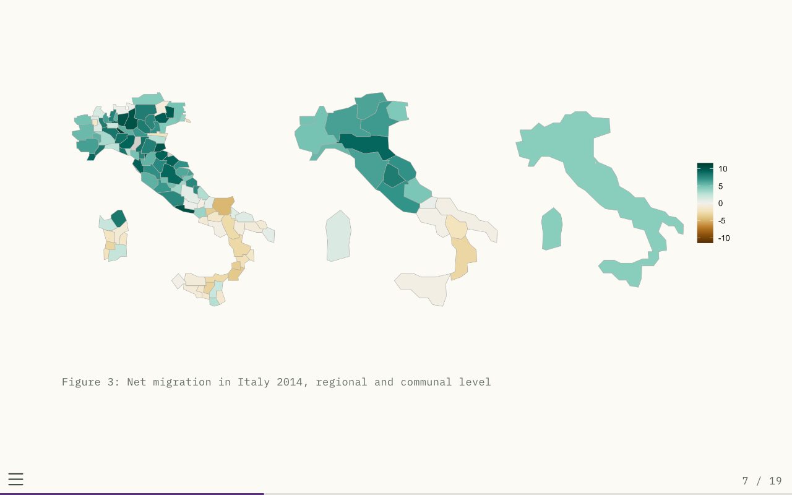
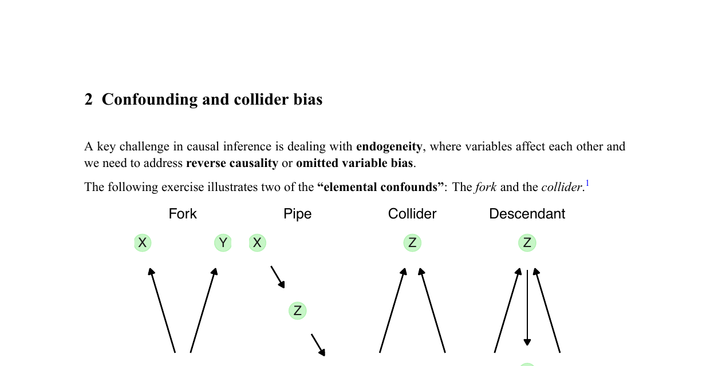

One text file and one command, and out comes a web page, a PDF, a set of
slides or a whole paper. An AI agent can do much of the typing, as long as you
read and check what it hands back. Two short tours show how, and the details
are left to the sources that cover them best.

::: {.ledger-links}
[One file, many outputs](#quarto) | [Let an agent do the typing](#agents) | [What stays with you](#judgement) | [Examples](#examples) | [Where to learn more](#reading)
:::

## [<i class="bi bi-file-earmark-text"></i>]{.h-icon} One file, many outputs {#quarto}

:::{.cr-section}

A report starts as one plain text file: a few settings, then text, then
code. @cr-source

The settings say what to make. Here, a web page. [@cr-source]{highlight="1-4"}

Numbers in the text are computed, not typed. Change the data and they change
with it. [@cr-source]{highlight="6"}

The code that draws a figure sits where the figure will appear. [@cr-source]{highlight="8-14"}

Run `quarto render` and the file becomes a web page, with numbered tables and
figures and links between them. @cr-web

Change `html` to `pdf`. Same file, now a PDF. @cr-pdf

Or to `revealjs`, for slides that run in any browser. @cr-slides

Figures can be maps. @cr-map

When the project grows, the same pieces make a paper or a thesis, with
equations, citations and a bibliography. @cr-paper

:::{#cr-source}
````{.markdown filename="report.qmd"}
---
title: "Migration in numbers"
format: html
---

The data cover `r n_countries` countries.

```{{r}}
#| label: fig-births
#| fig-cap: "Birth rates by decade"
ggplot(countries, aes(birth_rate)) +
  geom_histogram() +
  facet_wrap(~decade)
```

@fig-births shows how they are spread.
````
:::

:::{#cr-web}
{fig-alt="A report as a web page: title, text with computed numbers, and a numbered summary table."}
:::

:::{#cr-pdf}
{fig-alt="The same report as a PDF page."}
:::

:::{#cr-slides}
{fig-alt="A slide with a plot of estimated coefficients and their confidence intervals."}
:::

:::{#cr-map}
{fig-alt="Three maps of net migration in Italy, by commune, by region and for the country."}
:::

:::{#cr-paper}
{fig-alt="A page of a paper with a section heading, text, a diagram and its numbered caption."}
:::

:::

Quarto does one thing: it runs the code in a text file and puts the results
where they belong. So every number, table and figure comes from code, and one
command rebuilds the whole document from the raw data:

::: {.pipeline}
raw data [→]{.arrow} R code [→]{.arrow} Quarto document [→]{.arrow} web page · Word · PDF · slides
:::

Three habits keep it that way:

- **Never edit data by hand.** Keep the raw files as you got them and make
  every change in code.
- **Never copy a result into the text.** Numbers, tables and figures are
  computed where they appear.
- **Keep everything in plain text.** Scripts and Quarto files are text, so
  every change can be recorded and compared, and an agent can read and edit
  them.

The pay-off comes the second time round: when the data are updated or a
referee asks for another specification, you rerun instead of redo, and text and
results cannot drift apart.

::: {.ledger}

* [Try it]{.ledger-label} Install R, RStudio and
  [Quarto](https://quarto.org/docs/get-started/), then work through Quarto's
  own first tutorial, [Hello, Quarto](https://quarto.org/docs/get-started/hello/rstudio.html).
  After that, take apart *A first report* among the [examples](#examples).

:::

## [<i class="bi bi-robot"></i>]{.h-icon} Let an agent do the typing {#agents}

:::{.cr-section}

A coding agent is an AI assistant that works inside your project folder. It
reads the files, runs R and Quarto, and changes code and text. @cr-folder

Describe the project once, in a short file of notes that the agent reads
every time it starts. @cr-notes

Say how it can check its own work. [@cr-notes]{highlight="6-9"}

And say what is not its call. [@cr-notes]{highlight="11-17"}

Then ask for one thing, in plain words. @cr-ask

The agent works on a branch, a copy of the project. Your version stays as it
was. @cr-branch

What comes back is a list of changed lines. Here, a new table and a sentence
that points to it. @cr-diff

Read them before you accept them. This line leaves out countries without
data, though the notes said to ask first. Notes are requests, not locks. [@cr-diff]{highlight="9"}

So answer, as you would a colleague. @cr-reply

When the change is right, merge it: it joins your version, with a note of
what was done and why. @cr-merged

:::{#cr-folder}
```{.markdown filename="migration/"}
CLAUDE.md        notes for the agent
report.qmd       text and code
references.bib   sources
data/            the original data
```
:::

:::{#cr-notes}
```{.markdown filename="CLAUDE.md"}
# Project notes

A report on migration: text in Quarto,
analysis in R.

## Check your work
- `quarto render report.qmd` builds it.
- Render after every change.
- Fix every error before you finish.

## Data
- data/ holds the original files.
- Never change them.

## Ask first
- before leaving out any observations
- before changing a definition
```
:::

:::{#cr-ask}
::: {.tour-slip}
[You ask]{.tour-slip-label}

Add a table of the mean birth rate in each decade to `report.qmd` and refer
to it in the text. Render the report and fix any errors.
:::
:::

:::{#cr-branch}
```{=html}
<svg class="tour-diagram" viewBox="0 0 440 170" role="img" aria-label="Two lines of work: your version runs straight on, and the agent's branch splits off below it with three changes of its own.">
  <text x="30" y="26">your version</text>
  <path class="line" d="M30,50 H250"/>
  <path class="line agent" d="M150,50 C185,50 185,120 220,120 H360"/>
  <circle class="node" cx="70" cy="50" r="6"/>
  <circle class="node" cx="150" cy="50" r="6"/>
  <circle class="node agent" cx="240" cy="120" r="6"/>
  <circle class="node agent" cx="300" cy="120" r="6"/>
  <circle class="node agent" cx="360" cy="120" r="6"/>
  <text class="agent" x="220" y="152">the agent's branch</text>
</svg>
```
:::

:::{#cr-diff}
````{.diff filename="report.qmd"}
 @fig-births shows how they are spread.
+
+```{{r}}
+#| label: tbl-decade
+#| tbl-cap: "Mean birth rate by decade"
+countries |>
+  group_by(decade) |>
+  summarise(
+    mean = mean(birth_rate, na.rm = TRUE)
+  ) |>
+  kable(digits = 1)
+```
+
+@tbl-decade gives the mean by decade.
````
:::

:::{#cr-reply}
::: {.tour-slip}
[You answer]{.tour-slip-label}

How many countries does each mean leave out? Say so in a note under the
table.
:::
:::

:::{#cr-merged}
```{=html}
<svg class="tour-diagram" viewBox="0 0 440 170" role="img" aria-label="The agent's branch joins your version again: the change is merged after your review.">
  <text x="30" y="26">your version</text>
  <text x="410" y="26" text-anchor="end">merged, after your review</text>
  <path class="line" d="M30,50 H410"/>
  <path class="line agent" d="M150,50 C185,50 185,120 220,120 H340 C375,120 360,50 395,50"/>
  <circle class="node" cx="70" cy="50" r="6"/>
  <circle class="node" cx="150" cy="50" r="6"/>
  <circle class="node agent" cx="240" cy="120" r="6"/>
  <circle class="node agent" cx="290" cy="120" r="6"/>
  <circle class="node agent" cx="340" cy="120" r="6"/>
  <circle class="node" cx="395" cy="50" r="6"/>
  <text class="agent" x="220" y="152">the agent's branch</text>
</svg>
```
:::

:::

That is the whole workflow: describe the project once, give one task at a
time, let the agent work on a branch, review, merge. This page was written
that way.

::: {.ledger}

* [Try it]{.ledger-label} Put your project in a GitHub repository: a folder
  under version control, with a copy online where you can compare versions and
  review changes. Private repositories are free, and [Happy Git and GitHub for
  the useR](https://happygitwithr.com/) explains the one-time setup. Then give
  an agent one small task from the list below.

* [Tools]{.ledger-label} I use [Claude
  Code](https://code.claude.com/docs/en/overview), which also runs in the
  browser at [claude.ai/code](https://claude.ai/code), where each session works
  in the cloud on a copy of your repository. OpenAI's
  [Codex](https://developers.openai.com/codex) and GitHub's [Copilot coding
  agent](https://docs.github.com/en/copilot/concepts/agents/coding-agent/about-coding-agent)
  work along the same lines. These tools generally need a paid plan.

:::

### A file of instructions

The notes in the tour were a miniature. For a thesis in R and Quarto they
could start like this:

```{.markdown filename="CLAUDE.md"}
# Project notes

Master's thesis on [topic]. Text in Quarto (.qmd files), analysis in R.

## Build and check
- `quarto render` builds the thesis as PDF and web version into _book/.
- Render after every change; fix all errors and warnings before committing.
- `Rscript R/01_clean.R` rebuilds the clean data from data/raw/.

## Conventions
- Paths relative to the project folder; never setwd().
- tidyverse style with the |> pipe; one numbered script per step in R/.
- No numbers typed into the text: use inline R.
- British English, short sentences.

## Data
- data/raw/ holds the original files: never change them, never commit them
  (they are listed in .gitignore).
- Never print individual records.

## Ask before
- changing the sample, a variable definition or a model;
- deleting files or rewriting Git history.
```

Claude Code reads a file called `CLAUDE.md`; Codex, Copilot and most other
agents read `AGENTS.md`, a [shared format](https://agents.md/). Rules about
the statistics belong in it too. The instructions in the repository of my
journal club talk, for example, say: "report both models and the fixed
validation split. Do not select a model or split because it yields a stronger
signal"
([`AGENTS.md`](https://github.com/valentinklotzbuecher/jcod/blob/main/AGENTS.md)).
When the agent gets something wrong twice, add a line.

### Asking well

Write as you would to a capable research assistant who has not seen the
project: the goal, the context, and how you will judge the result. For
example:

- *Turn `analysis.R` into a Quarto report, `report.qmd`, that renders to HTML
  and Word. Hide the code in the output, put the numbers in the text with
  inline R, and cross-reference the figures. Render both formats and fix any
  errors.*
- *Review `R/03_models.R` for mistakes such as wrong variables, silently
  dropped missing values or factor coding. Don't change anything; list what you
  find with line numbers.*
- *Explain what `R/02_merge.R` does, step by step, for someone new to dplyr.*

For a larger change, ask for a plan first and agree on it before any code is
written. Keep tasks small: a session that does one thing is easier to review
than one that does five.

## [<i class="bi bi-person-check"></i>]{.h-icon} What stays with you {#judgement}

- **The decisions.** The research question, the analysis plan, the sample, the
  model and what the results mean. An agent will propose answers to all of
  them; they are yours to make and to defend.
- **The checking.** Read every change before you merge it, and rerun the
  analysis yourself. Agents are fast and sound sure of themselves when they are
  wrong: they misread a variable, or make a failing check pass by loosening it.
- **The data.** What the agent reads is sent to its provider. Keep
  identifiable personal data, such as patient data, out of the repository and
  out of the agent's reach, and follow your institution's rules. Where the real
  data cannot be shared, the agent can write and test the code on synthetic
  data with the same structure, and you run it on the real data yourself.
- **The rules on AI use.** Universities, journals and employers have them.
  Check what applies, and say how you used AI: in a thesis, usually in the
  declaration of independent work.

In a study I co-authored, [AI-assisted teams assessed the reproducibility of
published research better than AI-led teams, but not better than human-only
teams](https://doi.org/10.1073/pnas.2524747123).

## [<i class="bi bi-easel2"></i>]{.h-icon} Examples {#examples}

The files behind the pictures in the first tour, from a seminar I taught at
the University of Freiburg in the winter term 2024/25, *Reproducible Research
Pipelines with R and Quarto*.

::: {.ledger}

* [Report]{.ledger-label} **A first report**

  A Quarto document built step by step, with a summary table, a figure,
  cross-references and citations.

  ::: {.ledger-links}
  [Handout](handouts/getting-started.html) | [Source](source/getting-started.zip)
  :::

* [Formats]{.ledger-label} **One source, three formats**

  The same report as a web page with an interactive figure and as a PDF. The
  source also renders to Word.

  ::: {.ledger-links}
  [Web page](handouts/first-report.html) | [PDF](handouts/first-report.pdf) | [Source](source/first-report.zip)
  :::

* [Maps]{.ledger-label} **Maps**

  Maps of migration with ggplot2 and sf, an interactive map with leaflet, and
  two data sets merged by name and by location.

  ::: {.ledger-links}
  [Slides](slides/maps-and-merging.html) | [Source](source/maps-and-merging.zip)
  :::

* [Slides]{.ledger-label} **Slides**

  Simulated data, estimates and figures on slides, here on how to read p-values
  and confidence intervals.

  ::: {.ledger-links}
  [Slides](slides/interpreting-estimates.html) | [Source](source/interpreting-estimates.zip)
  :::

* [Paper]{.ledger-label} []{#template}**A paper or thesis**

  A project that sets up the title page, numbered sections, cross-references
  and a bibliography, as web pages and as a PDF.

  ::: {.ledger-links}
  [Template (.zip)](template/quarto-template.zip) | [Example PDF](template/example.pdf)
  :::

:::

The source bundles come without data; each says where to download it.

## [<i class="bi bi-bookmarks"></i>]{.h-icon} Where to learn more {#reading}

* [R for Data Science](https://r4ds.hadley.nz/) by H. Wickham, M. &Ccedil;etinkaya-Rundel and G. Grolemund, and the [Quarto guide](https://quarto.org/docs/guide/)

* Grant McDermott's [Data science for economists](https://github.com/uo-ec607/lectures) and Frank Harrell's [R Workflow](https://hbiostat.org/rflow/)

* [What They Forgot to Teach You About R](https://rstats.wtf/), on project folders and paths

* For particular outputs: [Geocomputation with R](https://r.geocompx.org/) on maps, [Slidecraft 101](https://emilhvitfeldt.com/project/slidecraft-101/) on slides, and my [Quarto thesis template](https://github.com/valentinklotzbuecher/ufr_thesis)

* On coding agents, the Claude Code documentation on [working in the browser](https://code.claude.com/docs/en/claude-code-on-the-web), [instruction files](https://code.claude.com/docs/en/memory) and [best practices](https://code.claude.com/docs/en/best-practices)

* On research design, [The Effect](https://theeffectbook.net/) by N. Huntington-Klein and [Causal Inference: The Mixtape](https://mixtape.scunning.com/) by S. Cunningham

* The [Big Book of R](https://www.bigbookofr.com/), for nearly everything else
